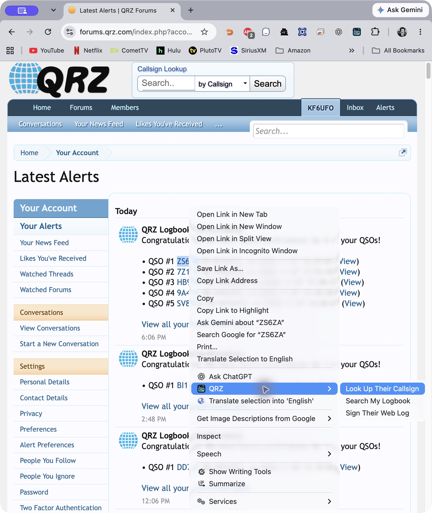

# QRZ Callsign Extension

Look up a station, search your QRZ Logbook, or sign a station’s Web Log from Chrome’s right-click menu. QRZ Callsign Extension puts these actions beside the callsign you’re reading, so you can spend less time copying callsigns and more time visiting station pages.

## What it does

| Menu action | What it does |
| --- | --- |
| **Look Up Their Callsign** | Opens the station’s QRZ biography. |
| **Search My Logbook** | Searches your QRZ Logbook for contacts with that station. |
| **Sign Their Web Log** | Checks the station’s visitor log, adds your signature when needed, and opens the biography afterward. |

On web pages, such as **QRZ Notifications**, you can right-click or select a station’s callsign and choose **QRZ**.

## Work through your confirmations

1. Open your [QRZ notifications](https://forums.qrz.com/index.php?account/alerts).
2. Right-click a station’s callsign in a confirmation.
3. Choose **QRZ → Sign Their Web Log**.

The extension handles the three common outcomes:

| Station’s Web Log | Result |
| --- | --- |
| You haven’t signed it | Adds a simple signature with an empty comment, confirms it was added, and displays the station’s biography. |
| You already signed it | Leaves the station tab open on Web with an “already signed” message. |
| The station doesn’t publish one | Displays the biography with a brief informational message. |

Your notifications page stays open. Signing uses a station tab in the same Chrome window where you chose the menu, and leaves that tab open when finished. It uses your existing QRZ sign-in.

A Web Log signature is a visitor greeting. It does not add a QSO or confirm a Logbook contact. If QRZ needs you to sign in or the result cannot be confirmed, the station page stays open with an explanation.

## Use it elsewhere

Highlight a single callsign on another page, right-click, and choose an action under **QRZ**. Lowercase and portable callsigns such as `EA8/W1AW`, `W1AW/P`, and `W1AW/7` are supported.

**Search My Logbook** brings an existing QRZ Logbook tab forward, including one in another Chrome window. If no Logbook tab is open, it opens one for you.

## Install

1. [Download the extension](https://github.com/kf6ufo/qrz-chrome-extension/archive/refs/heads/main.zip), extract the ZIP, and keep the extracted folder somewhere permanent.
2. Open `chrome://extensions` and enable **Developer mode**.
3. Click **Load unpacked** and select the folder containing `manifest.json`.
4. Sign in to QRZ in that Chrome profile, then refresh your notifications page.

Chrome will ask for access to QRZ’s station pages, Logbook, and notifications. If you have an older copy loaded from a different folder, turn it off before loading this copy. Keep the folder in place; Chrome uses those local files.

## Update

Replace the files in the installed extension’s folder with the latest download. At `chrome://extensions`, click **Reload** on **QRZ Callsign Extension**, then refresh your notifications page.

If you cloned [the repository](https://github.com/kf6ufo/qrz-chrome-extension), use `git pull --ff-only` to update the files before reloading. Each Chrome profile needs its own installation. For private windows, enable **Allow in incognito** in Chrome’s extension settings.

## Privacy

The extension uses your current QRZ session and sends the requested callsign or Web Log signature to QRZ when you choose an action. It does not store your credentials or activity history, include analytics, or load remote code.

Its site access covers QRZ station pages, QRZ Logbook, and the notifications page. It checks for an existing signature before signing and never automatically repeats a signature when the result is uncertain. Existing draft comments are left alone.

## For contributors

See the [verification report](tests/RESULTS.md) for test instructions, coverage, and live-check limits.

## License

[MIT](LICENSE). This is an independent helper, not an official QRZ product.
